# Docker DevOps Portfolio Project


A small web API that runs in Docker, stores data in a PostgreSQL database, and **deploys itself to an AWS server every time I push code to GitHub.**

> ✏️ **Before you commit:** search this file for `TODO` and fill in each one. Save all screenshots in a `docs/` folder with the exact names used below.

---

## What this project does

1. I write code and push it to GitHub.
2. GitHub **tests** the code automatically.
3. If the tests pass, GitHub **builds a Docker image** and uploads it to Docker Hub.
4. GitHub then **deploys** that image to my AWS server.
5. The server runs the API and the database using Docker Compose.

No manual copying of files. No logging in to the server to restart things. I push code, and everything else happens on its own.

---

## How it works

```text
   Me (git push)
        │
        ▼
   GitHub Actions
   ├── 1. Run tests
   └── 2. Build image → push to Docker Hub → deploy to AWS
                                                   │
                                                   ▼
                                           AWS EC2 server
                                        ┌──────────────────┐
                                        │  Docker Compose  │
                                        │  ┌─────┐ ┌─────┐ │
                                        │  │ API │ │ DB  │ │
                                        │  └─────┘ └─────┘ │
                                        └──────────────────┘
```

---

## Tools used (in simple words)

| Tool | What it does here |
|---|---|
| **FastAPI** (Python) | The web API |
| **PostgreSQL** | The database that stores data |
| **Docker** | Packs the app so it runs the same everywhere |
| **Docker Compose** | Starts the API and the database together |
| **Docker Hub** | Online storage for my Docker images |
| **GitHub Actions** | Runs tests and deploys automatically |
| **AWS EC2** | The server where the app runs |
| **AWS OIDC** | Lets GitHub prove who it is to AWS with a temporary pass, so no passwords are saved in GitHub |
| **AWS SSM** | Lets GitHub run commands on the server without opening SSH to the internet |
| **Pytest** | Runs the automatic tests |

---

## API endpoints

| Endpoint | What it tells you |
|---|---|
| `GET /` | The API is running |
| `GET /health` | The API is healthy |
| `GET /db-health` | The API can talk to the database |

---

## Good practices I used

- **Multi-stage Docker build:** the final image is smaller because build tools are left out.
- **Non-root user:** the app doesn't run as the all-powerful root user inside the container, which is safer.
- **Database in its own container with a volume:** the data is kept even if the container is deleted.
- **Health check:** the API waits until the database is ready before it starts.
- **Image tags:** each image is tagged with the Git commit ID, so I always know which version is running and can go back to an older one.
- **Tests before deploy:** broken code never reaches the server.
- **No saved AWS passwords:** GitHub uses OIDC, which gives it a temporary pass.
- **Secrets stay out of Git:** passwords live in a `.env` file that is never uploaded.

---

## Step by step, with proof

### 1. The AWS server

I created an EC2 instance, connected to it with SSH, and checked that Docker works.

**EC2 instance running**

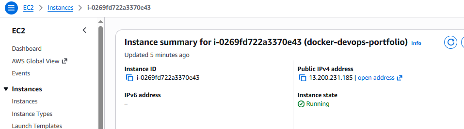

**Connected over SSH**

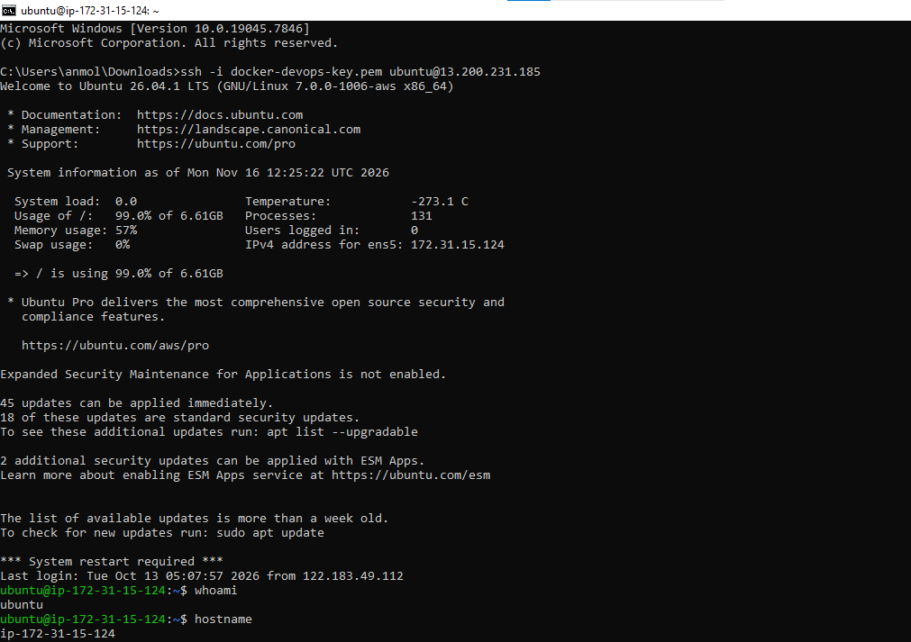

**Docker working (`hello-world`)**

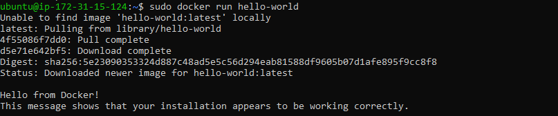

### 2. Running the app with Docker

The API and the database run as two containers, started together by Docker Compose.

**API container running and responding**

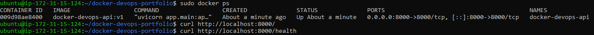

**API and PostgreSQL running through Docker Compose**

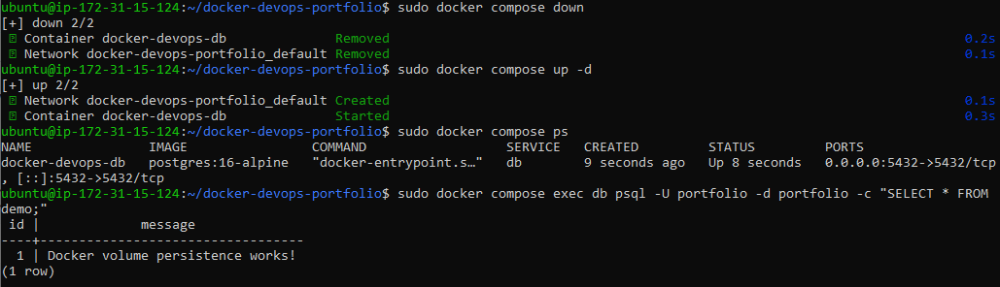

**Database healthy and the API connected to it**

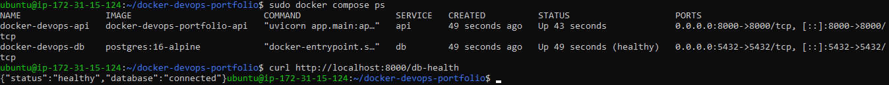

### 3. Making the image better

**Image size before and after the multi-stage build**

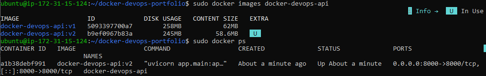

**Non-root user and the health check**

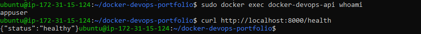

**Database data still there after the containers were removed and started again**

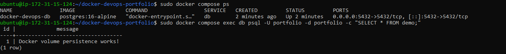

### 4. Automatic deployment

Every push to `main` runs the pipeline.

**Pipeline succeeded: tests and Docker job both green**

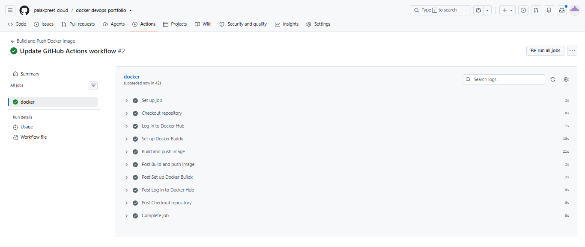

**Image published on Docker Hub**

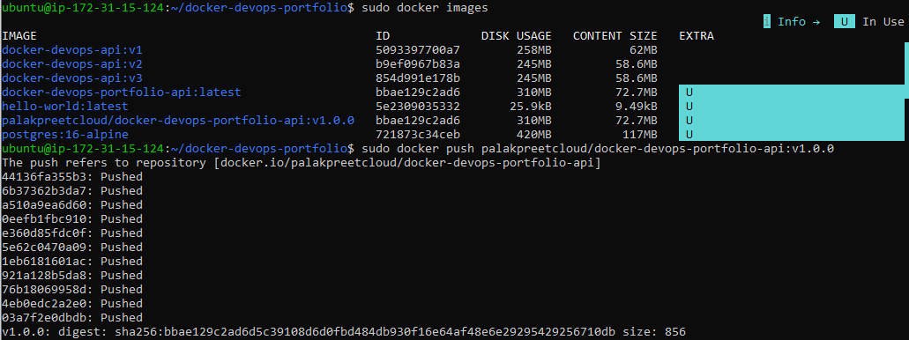

**The server is connected to AWS Systems Manager (online)**

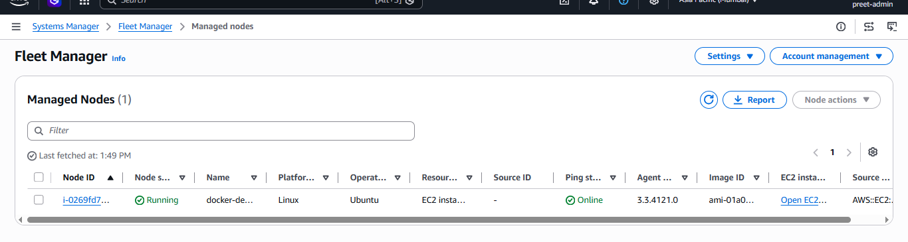

**The new image running on the server, and the database healthy**

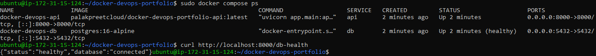

---

## Run it yourself

You need Docker and Git installed.

```bash
# 1. Download the project
git clone https://github.com/palakpreet-cloud/docker-devops-portfolio.git
cd docker-devops-portfolio

# 2. Create your settings file and set a strong password inside it
cp .env.example .env

# 3. Start the API and the database
docker compose up -d --build

# 4. Check that both are running
docker compose ps

# 5. Try the API
curl http://localhost:8000/
curl http://localhost:8000/health
curl http://localhost:8000/db-health

# 6. Stop everything (your data is kept)
docker compose down
```

Don't use `docker compose down -v` unless you want to delete the database data.

---

## Security

- No AWS keys are stored in GitHub (OIDC is used instead).
- Passwords are kept in `.env`, which is not uploaded to GitHub.
- The database is not open to the internet. Only the API can reach it.
- The app runs as a non-root user.
- EC2 security group: TODO (write exactly which ports you opened, for example "port 8000 open for the demo, SSH limited to my IP").

---

## Problems I faced and how I fixed them
 
**1. My tests could not find the app code**
- **Cause:** Python didn't know where the project's modules were when running the tests.
- **Fix:** I added an empty `app/__init__.py` so the `app` folder counts as a Python package. I now run the tests with `PYTHONPATH=. python -m pytest -v`, and I use the same setting in GitHub Actions.
 
**2. The server did not always run the image version I wanted**
- **Cause:** The deploy command used `sudo`, and `sudo` can drop environment variables. So my `IMAGE_TAG` variable never reached Docker Compose, and Compose could fall back to the `latest` tag.
- **Fix:** I passed the variable through `sudo` explicitly: `sudo env IMAGE_TAG=$IMAGE_TAG docker compose ...`. Now the server always runs the image for the exact Git commit.
**3. The database port was open on the server for no reason**
- **Cause:** My Compose file published PostgreSQL's port `5432` to the EC2 host, even though the API can reach the database through Docker's internal network.
- **Fix:** I removed the `5432:5432` port mapping. The API still connects using the Compose service name `db`, and the database is no longer reachable directly from the server's network.

---

## What I'd add next

- HTTPS with a real domain name
- Create the AWS server with Terraform instead of by hand
